# Document File Forensics Mini Lab Report

**Environment:** Kali Linux
**Date:** 4 November 2026
**Lab folder:** `~/document_forensics_lab/document_forensics_lab`

## 1. Aim

To identify the real file type of three sample documents, calculate their SHA-256 hashes, extract their metadata, look inside the DOCX and XLSX packages for hidden content, and inspect the PDF, while keeping the original files unchanged.

## 2. Part A: Lab Setup

I updated the package list and installed exiftool, unzip, file, python3 and python3-venv. Most of these were already installed. I then created a Python virtual environment called `docforensics-venv`.

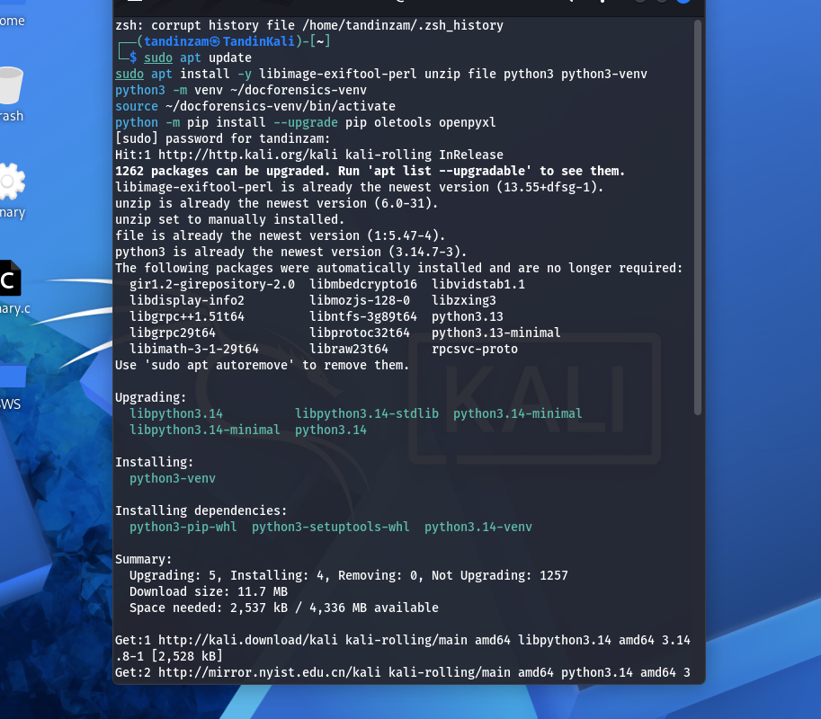

The first pip install failed because pip was trying to connect through a proxy at 127.0.0.1:8080 that was not running. After clearing the proxy variables with `unset`, openpyxl installed successfully. oletools was not needed because the samples do not contain macros.

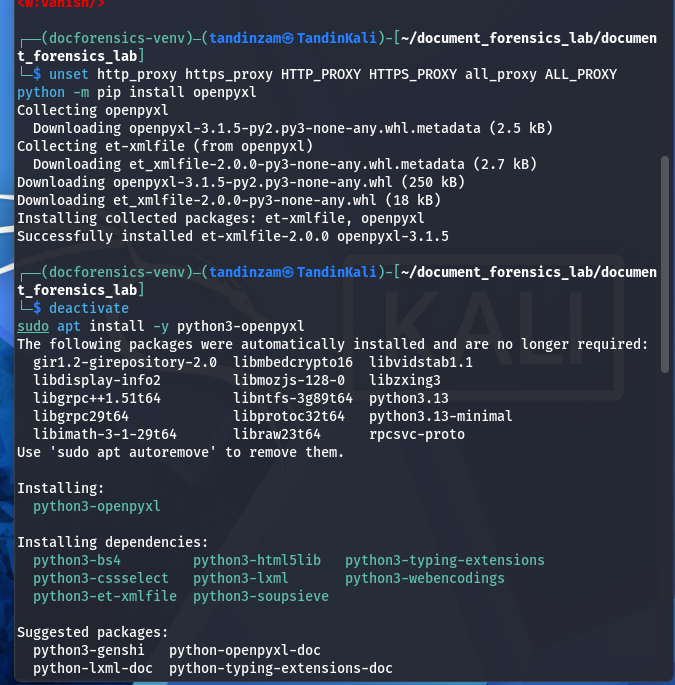

## 3. Part B: Preparing the Sample Folder

I created the lab folder and extracted `document_forensics_mini_lab.zip` into it. The zip created a subfolder with the same name, so I moved into that folder before running the rest of the commands.

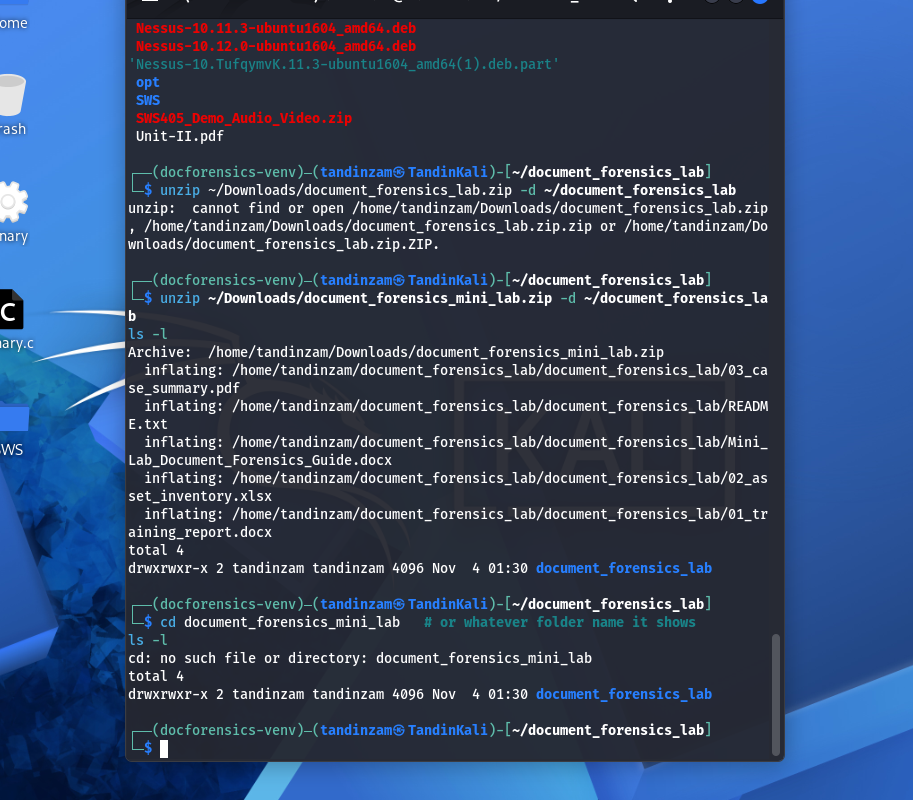

## 4. Part C: File Type and Hashes

I used `file` to check the real file type and `sha256sum` to hash each original file.

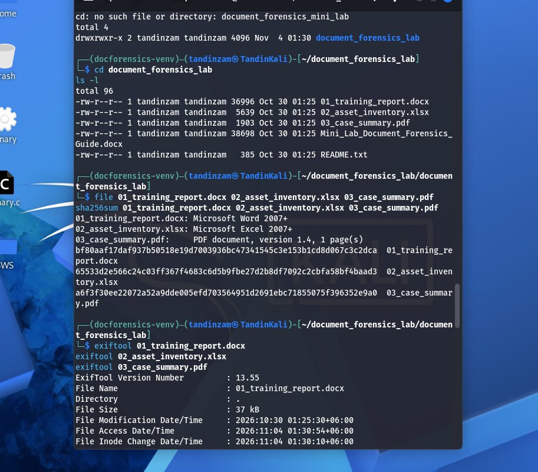

| File | Type (from `file`) | SHA-256 |
|---|---|---|
| 01_training_report.docx | Microsoft Word 2007+ | bf80aaf17daf937b50518e19d7003936bc47341545c3e153b1cd8d067c3c2dca |
| 02_asset_inventory.xlsx | Microsoft Excel 2007+ | 65533d2e566c24c03ff367f4683c6d5b9fbe27d2b8df7092c2cbfa58bf4baad3 |
| 03_case_summary.pdf | PDF document, version 1.4, 1 page | a6f3f30ee22072a52a9dde005efd703564951d2691ebc71855075f396352e9a0 |

The file types matched the extensions, so none of the files were disguised as another type.

## 5. Part D: Metadata Extraction

I ran `exiftool` on each file.

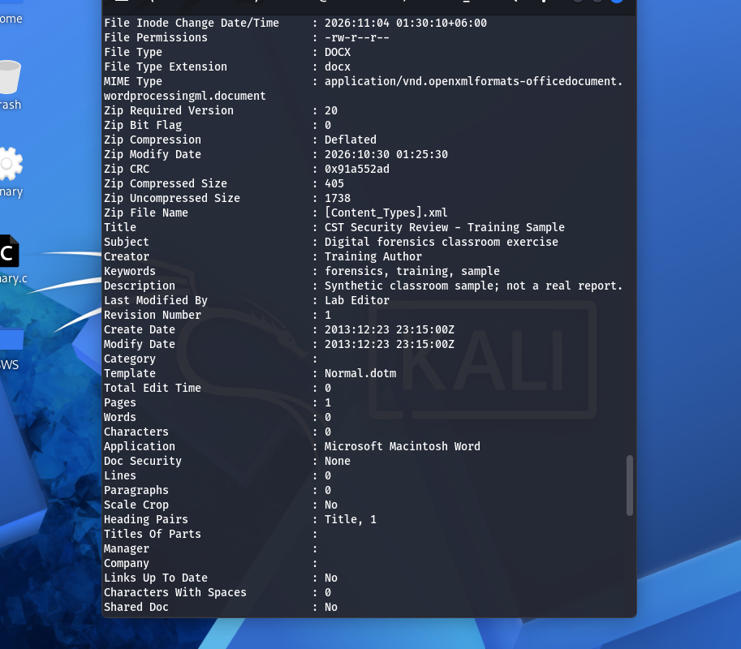
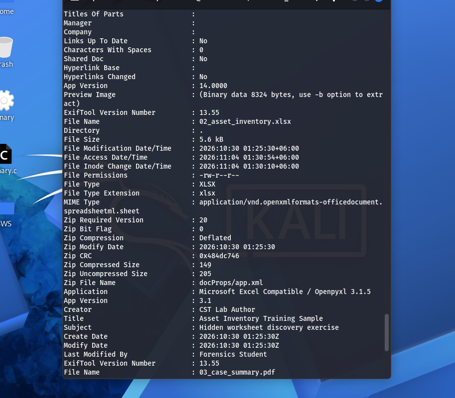
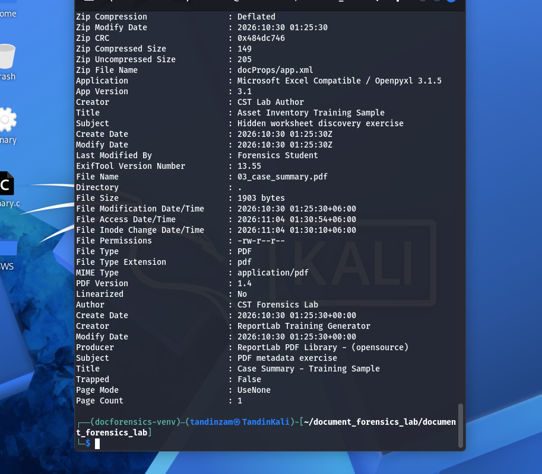

| Field | DOCX | XLSX | PDF |
|---|---|---|---|
| Title | CST Security Review - Training Sample | Asset Inventory Training Sample | Case Summary - Training Sample |
| Subject | Digital forensics classroom exercise | Hidden worksheet discovery exercise | PDF metadata exercise |
| Creator / Author | Training Author | CST Lab Author | CST Forensics Lab |
| Last Modified By | Lab Editor | Forensics Student | Not present |
| Create Date | 2013:12:23 23:15:00Z | 2026:10:30 01:25:30Z | 2026:10:30 01:25:30+00:00 |
| Modify Date | 2013:12:23 23:15:00Z | 2026:10:30 01:25:30Z | 2026:10:30 01:25:30+00:00 |
| Application / Producer | Microsoft Macintosh Word, version 14.0000 | Microsoft Excel Compatible / Openpyxl 3.1.5 | Creator: ReportLab Training Generator, Producer: ReportLab PDF Library - (opensource) |
| Other | Keywords: forensics, training, sample. Description: Synthetic classroom sample; not a real report. Template: Normal.dotm. Revision: 1 | App Version 3.1 | PDF version 1.4, 1 page, not linearized |

Two things stood out:

- The DOCX says it was created on 23 December 2013, but its Zip Modify Date is 30 October 2026. The internal files were packaged in 2026, so the 2013 date in the document properties does not match the package.
- Running exiftool changed the File Access Date/Time to the time of the lab. This is a filesystem timestamp, not part of the file contents, so the hash did not change.

## 6. Part E: Inspecting the DOCX Package

A DOCX file is a ZIP package, so I used `unzip -l` to list what is inside and `unzip -p` to read `docProps/core.xml`.

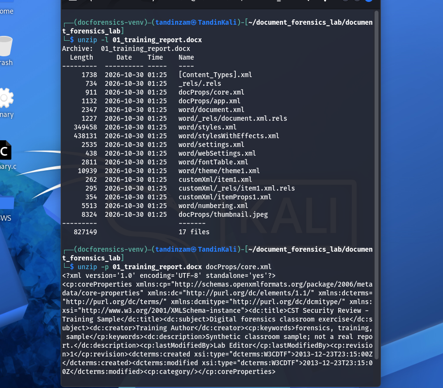

The package has 17 internal files, including `word/document.xml`, `docProps/core.xml`, `docProps/app.xml`, `customXml/item1.xml` and `docProps/thumbnail.jpeg`. All are dated 2026-10-30 01:25. The `core.xml` file holds the same title, creator, last modified by and 2013 dates that exiftool showed, so this is where exiftool reads those fields from.

I then searched `word/document.xml` for the training marker and for the hidden text tag.

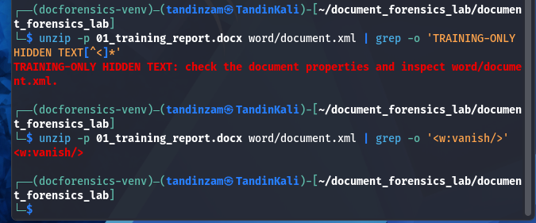

The marker found was:

> TRAINING-ONLY HIDDEN TEXT: check the document properties and inspect word/document.xml.

The XML also contains `<w:vanish/>`, which is Word's hidden text formatting. This means the text is stored in the file but is not shown when the document is opened normally.

## 7. Part F: Finding the Hidden Worksheet

I used openpyxl to list each sheet with its state and print the contents of `Internal_Notes`. I also checked `xl/workbook.xml` directly with unzip and grep.

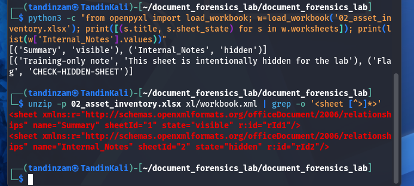

| Sheet | State | Contents |
|---|---|---|
| Summary | visible | Asset, Owner, Status table |
| Internal_Notes | hidden | "Training-only note: This sheet is intentionally hidden for the lab" and "Flag: CHECK-HIDDEN-SHEET" |

The `workbook.xml` file shows `name="Internal_Notes" sheetId="2" state="hidden"`, which confirms the result from openpyxl without needing to open the file in Excel or LibreOffice.

## 8. Part G: Inspecting the PDF

I ran exiftool on the PDF and then searched it with `strings`.

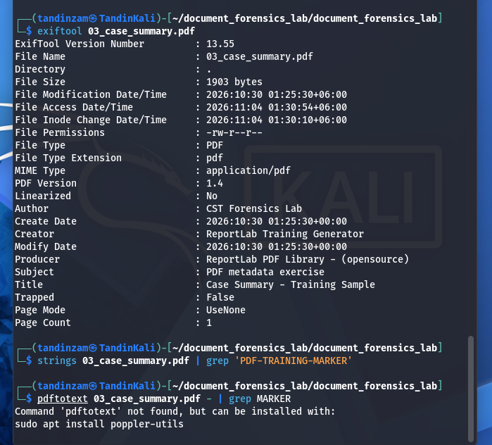

The `strings ... | grep 'PDF-TRAINING-MARKER'` command returned nothing. To find out why, I searched for the stream filter. The result was `/Filter [ /ASCII85Decode /FlateDecode ]`, which means the page text is encoded with ASCII85 and then compressed with Flate (zlib). Because of this, the marker is not stored as plain readable text, and `strings` cannot find it.

`pdftotext` was not installed, so I used a short Python command that reverses both encodings and searches the decoded page content. This found the marker:

> Training marker: PDF-TRAINING-MARKER-7319

At the end of the lab, I ran `sha256sum` again. All three hashes matched the ones from Part C, so the original files were not changed during the lab.

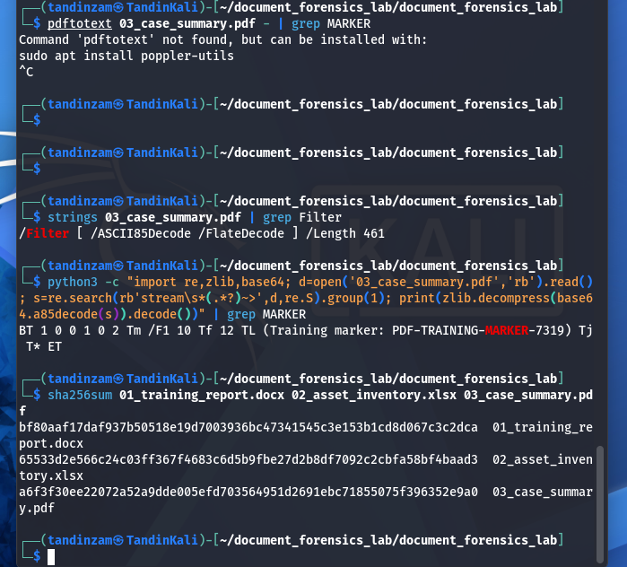

## 9. Part H: Findings Summary

### 01_training_report.docx

| Item | Finding |
|---|---|
| SHA-256 | bf80aaf17daf937b50518e19d7003936bc47341545c3e153b1cd8d067c3c2dca |
| File type | Microsoft Word 2007+ (OOXML) |
| Notable metadata | Creator: Training Author. Last Modified By: Lab Editor. Created and modified 2013-12-23. Application: Microsoft Macintosh Word 14.0 |
| Hidden content | "TRAINING-ONLY HIDDEN TEXT: check the document properties and inspect word/document.xml." formatted with `<w:vanish/>` |
| Commands used | file, sha256sum, exiftool, unzip -l, unzip -p, grep |
| Limitations | The 2013 creation date conflicts with the 2026 zip entry dates, so the stored dates cannot be trusted on their own |

### 02_asset_inventory.xlsx

| Item | Finding |
|---|---|
| SHA-256 | 65533d2e566c24c03ff367f4683c6d5b9fbe27d2b8df7092c2cbfa58bf4baad3 |
| File type | Microsoft Excel 2007+ (OOXML) |
| Notable metadata | Creator: CST Lab Author. Last Modified By: Forensics Student. Created 2026-10-30. Application: Openpyxl 3.1.5 |
| Hidden content | Worksheet Internal_Notes with state "hidden", containing the flag CHECK-HIDDEN-SHEET |
| Commands used | file, sha256sum, exiftool, python3 with openpyxl, unzip -p, grep |
| Limitations | The application field says "Microsoft Excel Compatible", but it was actually made with openpyxl, so the application name does not always mean the file came from Excel |

### 03_case_summary.pdf

| Item | Finding |
|---|---|
| SHA-256 | a6f3f30ee22072a52a9dde005efd703564951d2691ebc71855075f396352e9a0 |
| File type | PDF document, version 1.4, 1 page |
| Notable metadata | Author: CST Forensics Lab. Creator: ReportLab Training Generator. Producer: ReportLab PDF Library - (opensource). Created 2026-10-30 |
| Hidden / internal content | Marker PDF-TRAINING-MARKER-7319 inside an ASCII85 and Flate encoded content stream |
| Commands used | file, sha256sum, exiftool, strings, grep, python3 (zlib and base64) |
| Limitations | `strings` could not find the marker because the stream is compressed. A viewer or a decoding step is needed to see all the text |

### Observations and Conclusions

**Observations** (what the tools showed):

- All three files are the type their extensions say.
- The DOCX metadata dates (2013) differ from its zip entry dates (2026).
- The DOCX contains a text run marked with `<w:vanish/>`.
- The XLSX has a second sheet with state "hidden".
- The PDF text stream is ASCII85 and Flate encoded.
- The hashes were the same before and after the lab.

**Conclusions** (what I think the observations mean):

- The DOCX metadata was probably copied from a template or set by hand, since its dates do not match when the package was built.
- The hidden text and hidden sheet were placed on purpose for training, as the README says. In a real case, hidden content alone would not prove that someone was trying to hide something.
- The analysis did not change the samples, because the hashes stayed the same.

## 10. Answers to Questions

**1. Which metadata fields were present in each file?**
The DOCX had title, subject, creator, keywords, description, last modified by, revision number, create and modify dates, template, application and app version. The XLSX had title, subject, creator, last modified by, create and modify dates, application and app version. The PDF had title, subject, author, creator, producer, create and modify dates, PDF version and page count. It did not have a last modified by field.

**2. What training marker was found inside the DOCX package?**
"TRAINING-ONLY HIDDEN TEXT: check the document properties and inspect word/document.xml." It was in `word/document.xml` and hidden with the `<w:vanish/>` property.

**3. What was the name and state of the hidden worksheet?**
The sheet was named Internal_Notes and its state was hidden. It contained the flag CHECK-HIDDEN-SHEET.

**4. What PDF creator/producer information was visible?**
Creator was ReportLab Training Generator and Producer was ReportLab PDF Library - (opensource). The author field was CST Forensics Lab.

**5. Why is metadata alone insufficient to prove who created a file?**
Metadata can be edited easily, and many programs fill it in automatically from the username set on the computer or from a template. It shows what the software recorded, not who actually made the file. This lab shows the problem clearly. The DOCX says it was created in 2013, but its package was built in 2026, and the XLSX says "Microsoft Excel Compatible" even though it was made with a Python library. Metadata should be treated as a clue and backed up with other evidence, such as hashes, system logs and chain of custody records.

## 11. Conclusion

This lab showed that documents can hold more information than what is visible when they are opened. With basic tools like file, sha256sum, exiftool, unzip, grep and Python, I was able to find hidden text in a Word file, a hidden sheet in an Excel file and an encoded marker in a PDF. I also learned that one tool is not always enough, because `strings` missed the PDF marker until the stream was decoded. Recording the hashes at the start and end confirmed that the original files stayed unchanged.